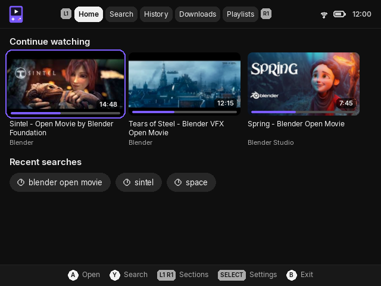
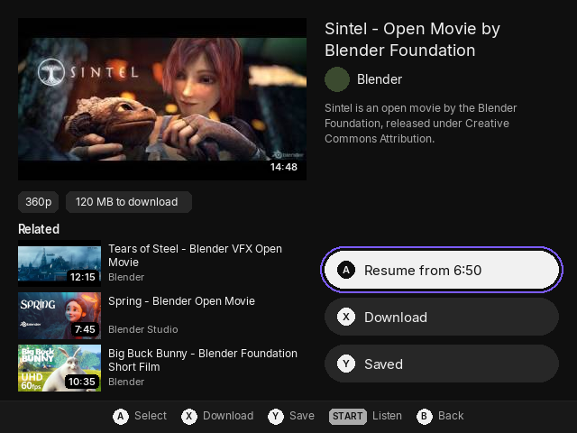
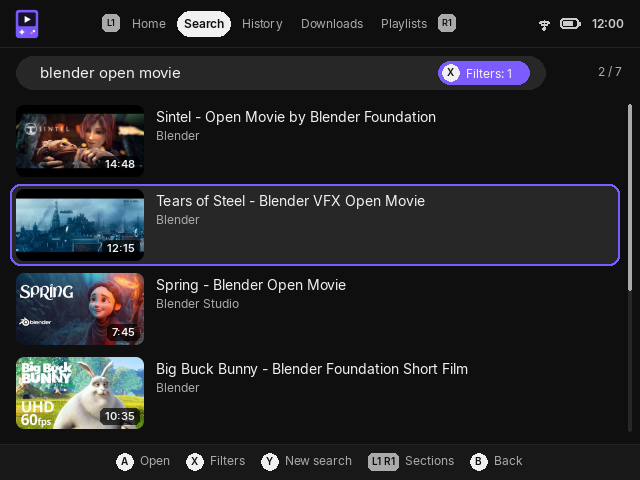
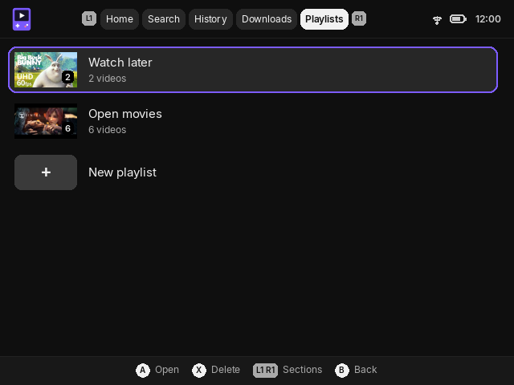
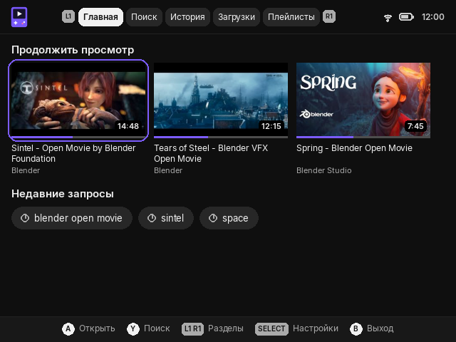
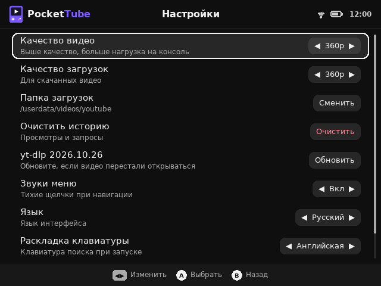
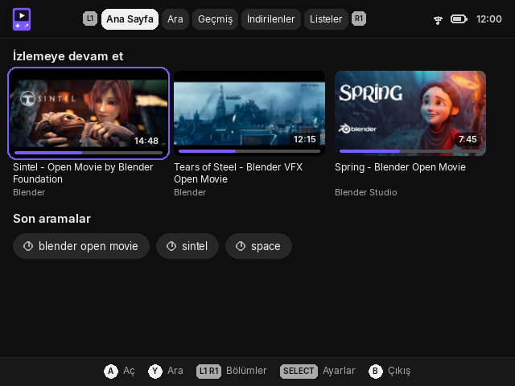
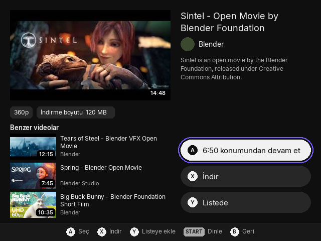

<p align="center"></p>

# PocketTube

An unofficial YouTube client for Linux handhelds with EmulationStation. Built and tested on the Anbernic RG40XX H (640×480), controlled entirely with the gamepad. The interface is available in English, Russian and Turkish.

> PocketTube is an unofficial client, not affiliated with or endorsed by YouTube or Google.

| | |
|---|---|
|  |  |
|  |  |
|  |  |
|  |  |

## Features

- Search with suggestions and filters (sort, upload date, duration, videos / live / playlists)
- Player with a progress bar, chapters, speed 0.5×–2×, subtitles (including auto-translated into the interface language) and a sleep timer
- Live streams
- Watch later, your own playlists, playing a whole playlist
- Related videos and "Continue watching" from where you stopped
- Downloads for offline viewing (240p–720p) or audio only (m4a, saved where music players see it)
- Audio-only playback with the screen turned off
- yt-dlp updates from the settings, with rollback
- English, Russian and Turkish interface; English, Russian (ЙЦУКЕН) and Turkish Q on-screen keyboard

## Install

You need a Linux handheld with EmulationStation, Wi‑Fi, and SSH or another way to copy files to the SD card. The installer expects the usual `/userdata` layout with a Ports system.

1. Download `pockettube-vX.Y.zip` from the releases page and copy it to the console, for example to `/userdata/`.
2. Unpack it and run the installer on the console:
   ```sh
   cd /userdata && unzip pockettube-v1.0.zip && bash pockettube/install.sh
   ```
3. Open **Ports → PocketTube**.

The installer copies the app to `/userdata/system/pockettube`, the launcher to `/userdata/roms/ports`, downloads yt-dlp and deno, and adds the name, description and artwork to the Ports carousel. Re-running it is safe: settings, history, playlists and downloads are kept, and changed files are backed up to `pockettube/backup-<date>/`.

If you used an earlier version (the `ytclient` folder and `YouTube.sh`), the installer backs it up to `/userdata/system/pockettube-migration-backup-<date>/` and moves your data over.

| Option | What it does |
|---|---|
| `--no-deno` | don't install deno (saves ~85 MB; some videos then play in 480p instead of 720p) |
| `--update-ytdlp` | install the latest yt-dlp even if one is already there |
| `--no-es` | don't touch the carousel |
| `--prefix DIR` | install into another folder, for testing |

## Controls

| Button | Action |
|---|---|
| D-pad | move |
| A | select / watch |
| B | back / exit |
| X | erase a character; delete or cancel a download; filters in search results |
| Y | space; open search; save to a playlist |
| START | search; listen (audio only) on the video screen; play all in a playlist |
| SELECT | settings |
| L1 / R1 | sections: Home, Search, History, Downloads, Playlists |
| HOTKEY + START | force-quit the app and the player |

### Player

| Button | Action |
|---|---|
| A | pause / play |
| B | exit (the position is remembered) |
| ◀ ▶ | back / forward 10 seconds |
| ▲ ▼ | forward / back 1 minute |
| L1 / R1 | previous / next chapter (±5 minutes without chapters) |
| X | subtitles on / off |
| Y | menu: speed, subtitles, chapters, audio only, sleep timer, controls |
| SELECT | keep the progress bar on screen |
| START | controls help |

## FAQ

**Videos stopped opening.** YouTube changes often. Open **Settings → yt-dlp → Update**. If the new version misbehaves, pick **Roll back** with ◀ ▶.

**720p takes longer to start.** For some videos YouTube only offers 720p after a JavaScript check. PocketTube first tries without it and only then runs deno, which takes about 10 seconds on the console. Lower qualities never need it.

**Where are my downloads?** Videos go to `/userdata/videos/youtube` (or the app folder, see Settings). Audio-only downloads go to `/userdata/music/youtube`.

**No sound in the menus.** Turn on **Settings → Menu sounds**. The video sound is independent of this setting.

**How do I remove PocketTube?** Delete `/userdata/system/pockettube`, `/userdata/roms/ports/PocketTube.sh`, `PocketTube.sh.keys` and `images/pockettube-*.png`, then restart EmulationStation.

## Building

```sh
python build.py
```

writes `dist/pockettube-vX.Y.zip` (the version comes from `APP_VERSION` in `main.py`). `tools/logo.py` regenerates the logo and carousel art; `tools/screenshots.py` regenerates the screenshots with demo data (the optional argument is a folder with DejaVu fonts, used only as a fallback). `tools/perf.py` measures how long each screen takes to draw; run it on the handheld from a copy of the repository to check the interface keeps up with 30 fps.

The console's mpv is built without Lua, so `player.py` drives mpv over its IPC socket: buttons arrive as `script-message` events (see `player-input.conf`) and the overlay is drawn with `osd-overlay`.

```
userdata/system/pockettube/  main.py (UI), player.py (player and overlay), youtube.py (yt-dlp),
                             services.py (thumbnails, downloads, network), store.py (data.json),
                             sounds.py (menu sounds), i18n.py (English/Russian/Turkish strings), assets/
userdata/roms/ports/         PocketTube.sh (launcher), PocketTube.sh.keys (buttons → keys), images/
install.sh                   installer
build.py                     release archive
tools/                       logo and screenshot generators, frame-time benchmark
```

## License

Screenshot thumbnails come from freely licensed films: Blender Foundation / Blender Studio (CC BY 3.0 / 4.0) and NASA (public domain); see [THIRD_PARTY.md](THIRD_PARTY.md).


MIT, see [LICENSE](LICENSE). Third-party components and their licenses are listed in [THIRD_PARTY.md](THIRD_PARTY.md). Changes are listed in [CHANGELOG.md](CHANGELOG.md).
